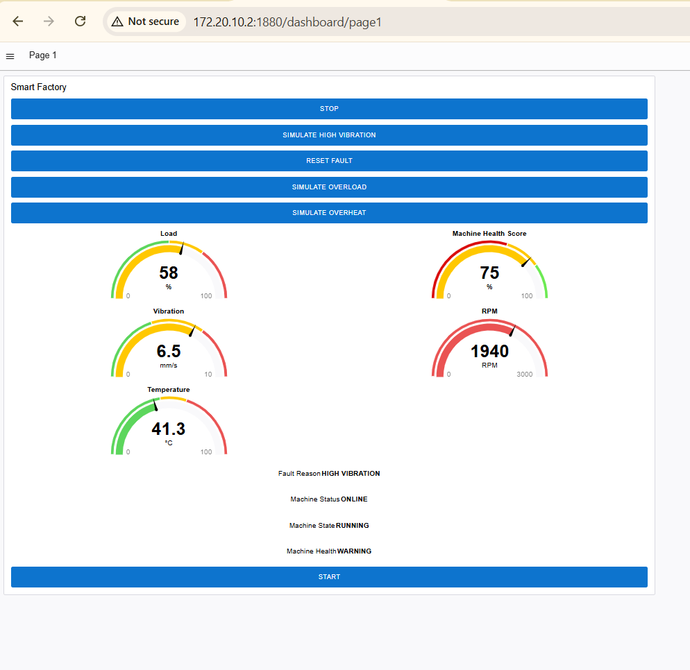
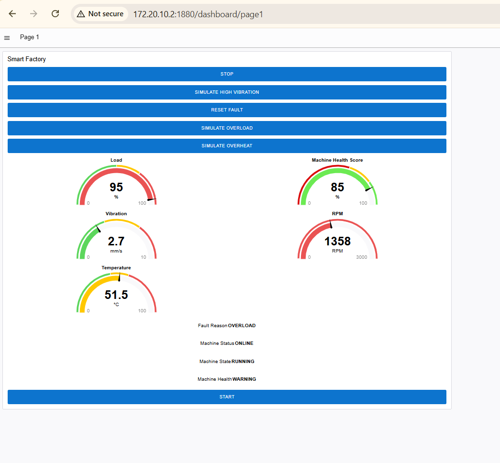
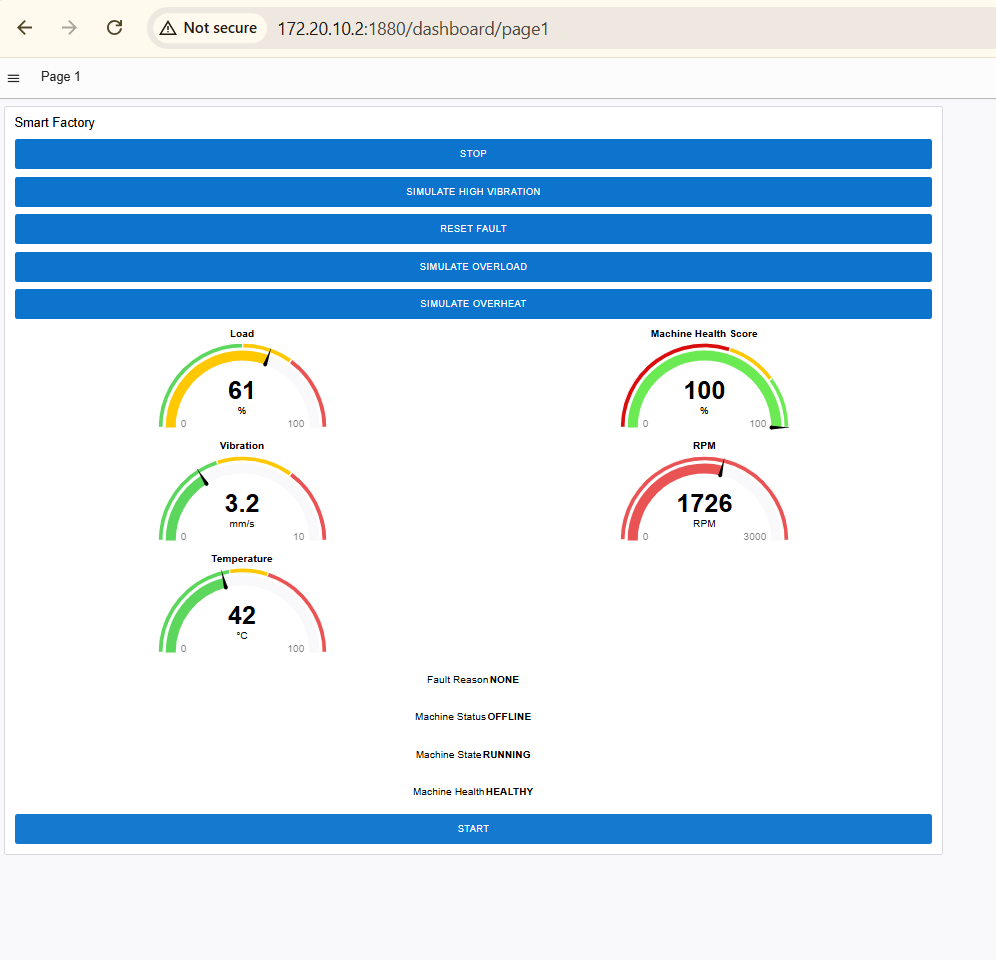
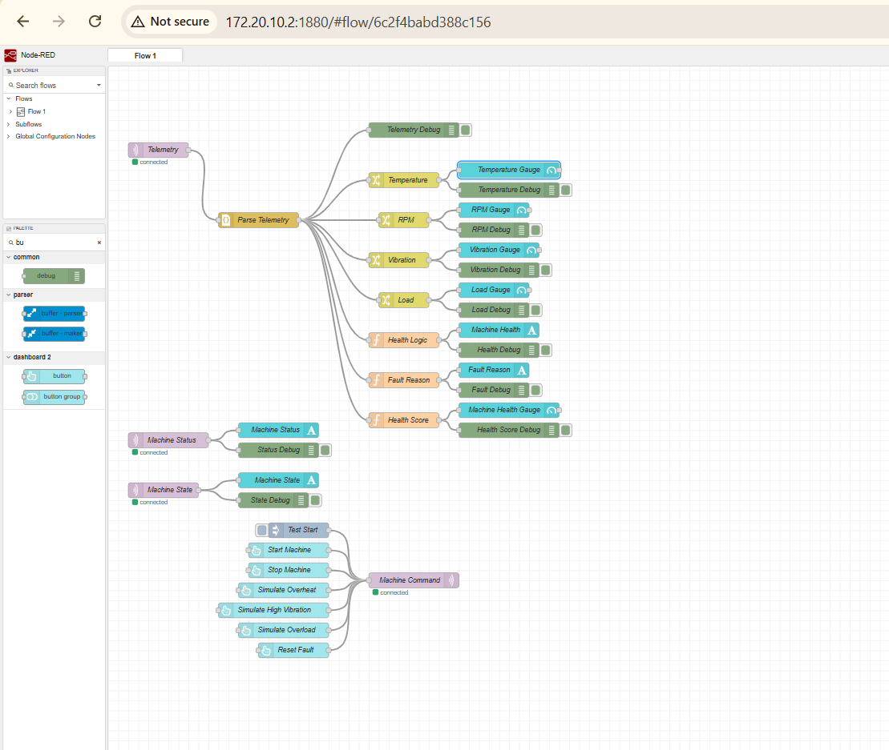

# Smart Factory Digital Twin using MQTT

A simulation-based Smart Factory Digital Twin prototype built using an **ESP32-S3**, **Raspberry Pi**, **Mosquitto MQTT Broker**, **Node-RED**, and **FlowFuse Dashboard**.

The project demonstrates how MQTT can be used for real-time IoT messaging, machine monitoring, remote control, fault simulation, machine-health evaluation, and MQTT Last Will functionality.

---

## Project Overview

This project represents a simplified industrial machine called:

`MACHINE_01`

The ESP32-S3 acts as the simulated industrial machine.

It generates machine telemetry and sends the data to a Raspberry Pi using MQTT.

The Raspberry Pi runs:

- Mosquitto MQTT Broker
- Node-RED
- FlowFuse Dashboard

Node-RED receives the telemetry, processes the machine data, calculates machine health, identifies faults, and displays the results on a web dashboard.

The dashboard can also send control commands back to the ESP32.

---

## System Architecture

The communication flow is:

```text
ESP32-S3
   |
   | MQTT Telemetry
   v
Mosquitto MQTT Broker
   |
   v
Node-RED
   |
   v
FlowFuse Dashboard
```

Control commands travel in the opposite direction:

```text
FlowFuse Dashboard
        |
        v
Node-RED
        |
        | MQTT Command
        v
Mosquitto Broker
        |
        v
ESP32-S3
```

---

## Hardware Used

- ESP32-S3 Development Board
- Raspberry Pi 3 Model B+
- microSD card
- USB cable
- Windows computer
- Wi-Fi / mobile hotspot

No physical temperature, vibration, RPM, or load sensors are required for this prototype.

The main machine measurements are simulated in software.

---

## Software Used

- Arduino IDE
- ESP32 Arduino Core
- PubSubClient
- Raspberry Pi OS Lite 64-bit
- Eclipse Mosquitto
- Node-RED
- FlowFuse Dashboard 2.0
- SSH
- Git
- GitHub

---

## Main Features

- Real-time MQTT communication
- ESP32-S3 telemetry publishing
- Node-RED telemetry processing
- Web-based Digital Twin dashboard
- START and STOP machine control
- Overheat fault simulation
- High-vibration fault simulation
- Overload fault simulation
- Fault reset
- Machine health monitoring
- Rule-based health score
- Machine state monitoring
- MQTT retained messages
- MQTT Last Will and Testament
- Automatic OFFLINE detection
- Real ESP32 Wi-Fi RSSI monitoring
- ESP32 uptime reporting

---

## MQTT Topics

The project uses four main MQTT topics.

| Topic | Direction | Purpose |
|---|---|---|
| `factory/machine01/telemetry` | ESP32 → Broker | Machine telemetry |
| `factory/machine01/status` | ESP32 → Broker | ONLINE / OFFLINE status |
| `factory/machine01/state` | ESP32 → Broker | RUNNING / STOPPED state |
| `factory/machine01/command` | Node-RED → ESP32 | Machine control commands |

---

## Telemetry Data

The ESP32 publishes JSON telemetry approximately every 2 seconds.

Example:

```json
{
  "temperature": 45.2,
  "rpm": 1825,
  "vibration": 2.1,
  "load": 58,
  "rssi": -48,
  "uptime": 120
}
```

The telemetry contains:

- Temperature
- RPM
- Vibration
- Load
- Wi-Fi RSSI
- ESP32 uptime

---

## Simulated and Real Data

This project does not use physical industrial sensors.

The following values are simulated:

| Parameter | Type |
|---|---|
| Temperature | Simulated |
| RPM | Simulated |
| Vibration | Simulated |
| Load | Simulated |
| RSSI | Real ESP32 value |
| Uptime | Real ESP32 value |

This makes the project suitable for learning MQTT, Node-RED, IoT messaging, and Digital Twin concepts without requiring industrial sensors.

---

## Normal Machine Values

When the machine is running normally:

| Parameter | Normal Range |
|---|---|
| Temperature | 35–54 °C |
| RPM | 1200–2400 RPM |
| Vibration | 1.0–3.4 mm/s |
| Load | 30–74% |

When the machine is stopped:

```text
RPM = 0
Vibration = 0
Load = 0
```

Temperature remains at a lower simulated value.

---

## Machine Control Commands

The dashboard can send the following MQTT commands:

```text
START
STOP
FAULT_OVERHEAT
FAULT_VIBRATION
FAULT_OVERLOAD
RESET_FAULT
```

### START

Starts the simulated machine.

Expected state:

```text
RUNNING
```

### STOP

Stops the simulated machine.

Expected result:

```text
RPM = 0
Vibration = 0
Load = 0
State = STOPPED
```

---

## Fault Simulation

The project includes three simulated machine faults.

### Overheat Fault

Command:

```text
FAULT_OVERHEAT
```

Expected result:

```text
Temperature = 85 °C
Machine Health = WARNING
Fault Reason = HIGH TEMPERATURE
Health Score = 80%
```

### High Vibration Fault

Command:

```text
FAULT_VIBRATION
```

Expected result:

```text
Vibration = 6.5 mm/s
Machine Health = WARNING
Fault Reason = HIGH VIBRATION
Health Score = 75%
```

### Overload Fault

Command:

```text
FAULT_OVERLOAD
```

Expected result:

```text
Load = 95%
Machine Health = WARNING
Fault Reason = OVERLOAD
Health Score = 85%
```

### Reset Fault

Command:

```text
RESET_FAULT
```

Expected result:

```text
Machine Health = HEALTHY
Fault Reason = NONE
Health Score = 100%
```

---

## Health Logic

Node-RED evaluates the telemetry using the following thresholds:

```text
Temperature > 55 °C
Vibration > 3.5 mm/s
Load > 75%
```

If any threshold is exceeded:

```text
Machine Health = WARNING
```

Otherwise:

```text
Machine Health = HEALTHY
```

---

## Health Score

The machine starts with a health score of:

```text
100%
```

Penalties are applied when abnormal conditions are detected.

```text
High Temperature: -20
High Vibration:   -25
Overload:         -15
```

Examples:

```text
Normal Machine = 100%
Overheat = 80%
High Vibration = 75%
Overload = 85%
```

The health score is a simple rule-based demonstration.

It is not a machine-learning or predictive-maintenance algorithm.

---

## MQTT Last Will and Testament

The ESP32 uses MQTT Last Will and Testament to indicate an unexpected disconnection.

When the ESP32 connects:

```text
factory/machine01/status = ONLINE
```

If the ESP32 suddenly loses power or its MQTT connection, the broker publishes:

```text
factory/machine01/status = OFFLINE
```

This allows the Digital Twin dashboard to detect when the physical device is unavailable.

The status message is retained by the MQTT broker.

---

## Node-RED Dashboard

The FlowFuse dashboard displays:

- Temperature
- RPM
- Vibration
- Load
- Machine Health Score
- Machine Health
- Fault Reason
- Machine Status
- Machine State

The dashboard also provides controls for:

- START
- STOP
- SIMULATE OVERHEAT
- SIMULATE HIGH VIBRATION
- SIMULATE OVERLOAD
- RESET FAULT

---

## Dashboard - Normal Operation


Normal operation should display:

```text
Machine Status: ONLINE
Machine State: RUNNING
Machine Health: HEALTHY
Fault Reason: NONE
Health Score: 100%
```

---

## Dashboard - Machine Stopped


When the machine is stopped:

```text
Machine State: STOPPED
RPM: 0
Vibration: 0
Load: 0
```

---

## Overheat Fault


---

## High Vibration Fault



---

## Overload Fault



---

## MQTT Offline Detection



The ESP32 was disconnected intentionally to demonstrate MQTT Last Will functionality.

The dashboard automatically changed the machine status to:

```text
OFFLINE
```

---

## Node-RED Flow



Node-RED is responsible for:

- Receiving MQTT telemetry
- Parsing JSON messages
- Separating telemetry values
- Calculating machine health
- Determining fault reasons
- Calculating the health score
- Updating the dashboard
- Receiving dashboard commands
- Publishing MQTT commands

---

## ESP32 MQTT Communication


The Serial Monitor can be used to verify:

- Wi-Fi connection
- MQTT connection
- MQTT subscriptions
- Received commands
- Published telemetry

---

# Installation and Setup

## 1. Raspberry Pi Setup

Install Raspberry Pi OS Lite 64-bit.

Enable SSH during the Raspberry Pi installation.

Update the system:

```bash
sudo apt update
sudo apt upgrade -y
```

---

## 2. Install Mosquitto

Install the MQTT broker and command-line clients:

```bash
sudo apt install mosquitto mosquitto-clients -y
```

Enable Mosquitto:

```bash
sudo systemctl enable mosquitto
```

Check its status:

```bash
sudo systemctl status mosquitto
```

---

## 3. Configure Mosquitto

The project configuration is located in:

```text
mosquitto/digital-twin.conf
```

Configuration:

```conf
listener 1883
allow_anonymous true
```

On the Raspberry Pi, place it inside:

```text
/etc/mosquitto/conf.d/
```

Restart Mosquitto:

```bash
sudo systemctl restart mosquitto
```

---

## 4. Test MQTT

Subscribe:

```bash
mosquitto_sub -h localhost -t test/topic
```

Open another terminal and publish:

```bash
mosquitto_pub -h localhost -t test/topic -m "MQTT working"
```

The subscriber should receive:

```text
MQTT working
```

---

## 5. Install Node-RED

Install Node-RED using the official Raspberry Pi installation method.

After installation, start Node-RED:

```bash
node-red-start
```

Open the Node-RED editor:

```text
http://RASPBERRY_PI_IP:1880
```

---

## 6. Install FlowFuse Dashboard

Inside Node-RED, install:

```text
@flowfuse/node-red-dashboard
```

This project uses FlowFuse Dashboard 2.0.

---

## 7. Import the Node-RED Flow

The Node-RED flow is available at:

```text
node-red/flows.json
```

In Node-RED:

```text
Menu
→ Import
→ Select a file
→ flows.json
→ Import
→ Deploy
```

---

## 8. ESP32 Setup

Open:

```text
esp32/Smart_Factory_Digital_Twin_ESP32/
```

Then open:

```text
Smart_Factory_Digital_Twin_ESP32.ino
```

Install the Arduino library:

```text
PubSubClient by Nick O'Leary
```

Select:

```text
ESP32S3 Dev Module
```

---

## 9. Configure Wi-Fi

Before uploading the ESP32 program, change:

```cpp
const char* ssid = "YOUR_WIFI_NAME";
const char* password = "YOUR_WIFI_PASSWORD";
```

Never commit real Wi-Fi credentials to a public GitHub repository.

---

## 10. Configure MQTT Broker Address

Set the Raspberry Pi's local IP address:

```cpp
const char* mqtt_server = "YOUR_RASPBERRY_PI_IP";
```

Example:

```cpp
const char* mqtt_server = "172.20.10.2";
```

The Raspberry Pi and ESP32 must be connected to the same local network.

---

## 11. Upload the ESP32 Program

Connect the ESP32-S3 using USB.

Upload the Arduino sketch.

Open Serial Monitor at:

```text
115200 baud
```

A successful connection should show messages similar to:

```text
Wi-Fi connected!
Connecting to MQTT broker...CONNECTED!
Subscribed to command topic
MQTT telemetry sent:
```

---

## 12. Open the Dashboard

The dashboard can be opened at:

```text
http://RASPBERRY_PI_IP:1880/dashboard/page1
```

Example:

```text
http://172.20.10.2:1880/dashboard/page1
```

---

# Recommended Startup Procedure

When starting the project:

```text
1. Turn on the Wi-Fi / hotspot
2. Power the Raspberry Pi
3. Wait for Mosquitto and Node-RED to start
4. Power the ESP32-S3
5. Wait for MQTT connection
6. Open the dashboard
```

The dashboard should show:

```text
Machine Status: ONLINE
```

---

# Shutdown Procedure

The Raspberry Pi should always be shut down properly.

Connect through SSH and run:

```bash
sudo poweroff
```

Wait until Raspberry Pi activity has stopped before removing power.

The ESP32 can then be disconnected from USB or power.

---

# Project Folder Structure

```text
Smart-Factory-Digital-Twin-MQTT/
│
├── README.md
│
├── esp32/
│   └── Smart_Factory_Digital_Twin_ESP32/
│       └── Smart_Factory_Digital_Twin_ESP32.ino
│
├── node-red/
│   └── flows.json
│
├── mosquitto/
│   └── digital-twin.conf
│
└── docs/
    ├── dashboard-normal.png
    ├── dashboard-stopped.png
    ├── dashboard-overheat.png
    ├── dashboard-vibration.png
    ├── dashboard-overload.png
    ├── dashboard-offline.png
    ├── node-red-flow.png
    └── esp32-serial-monitor.png
```

---

# Security Considerations

This project is designed as a classroom and learning prototype.

The Mosquitto configuration currently uses:

```conf
allow_anonymous true
```

This simplifies MQTT testing on an isolated local network.

For a production IoT system, additional security should be implemented, including:

- MQTT username and password authentication
- Access Control Lists
- TLS encryption
- Device certificates
- Secure credential storage
- Firewall rules
- HTTPS for web interfaces
- Network segmentation

Anonymous MQTT should not normally be exposed to an untrusted or public network.

---

# Limitations

This is a simplified Digital Twin prototype.

Current limitations include:

- Machine measurements are simulated
- No industrial sensors are connected
- Health score uses fixed rules
- No historical database is implemented
- No machine-learning model is used
- No predictive-maintenance algorithm is implemented
- MQTT authentication is not enabled
- MQTT traffic is not encrypted with TLS
- Raspberry Pi IP address may change depending on the network

Despite these limitations, the system demonstrates the main communication and monitoring concepts used in MQTT-based IoT and Digital Twin systems.

---

# What I Learned

Through this project, I practiced and learned:

- MQTT publish/subscribe communication
- MQTT topics
- MQTT QoS
- Retained messages
- MQTT Last Will and Testament
- ESP32 Wi-Fi communication
- JSON telemetry
- Raspberry Pi configuration
- Mosquitto MQTT broker configuration
- Node-RED flow development
- FlowFuse Dashboard development
- Bidirectional IoT communication
- Machine-state control
- Fault simulation
- Rule-based health monitoring
- Digital Twin concepts
- Linux SSH commands
- IoT troubleshooting
- Project documentation
- Git and GitHub project organization

---

# Possible Future Improvements

Possible future improvements include:

- Connect real temperature sensors
- Add a real vibration sensor
- Measure real motor RPM
- Add current and power sensors
- Store telemetry in a database
- Add historical charts
- Add predictive maintenance
- Add anomaly detection
- Add MQTT authentication
- Add TLS encryption
- Add multiple machines
- Deploy the dashboard remotely
- Add alerts and notifications
- Add machine-learning-based health prediction

---

# Technologies

`ESP32-S3` `Raspberry Pi` `MQTT` `Mosquitto` `Node-RED` `FlowFuse Dashboard` `Arduino` `IoT` `Digital Twin` `JSON` `Linux`

---

# Authors & Maintainers

Developed and maintained by:

- **Numaer Abdus Salique**  
  GitHub: [numaer21](https://github.com/numaer21)

- **Nirzor Deb Opi**  
  GitHub: [nirzor-deb-25](https://github.com/nirzor-deb-25)

---

# Educational Purpose

This project was created for learning and demonstrating:

- Internet of Things
- MQTT messaging
- Digital Twin communication
- Smart Factory concepts
- Industrial IoT fundamentals

It is a learning prototype and is not intended to be used directly as a production industrial control system.
